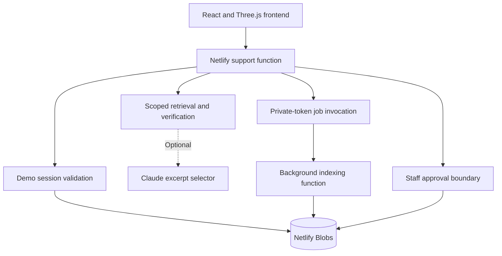

# Groundwork: Netlify architecture

Version 1.0 · 19 October 2026. This describes the code in this ZIP, not the separate Cloudflare/Sites deployment.

## Application boundaries

Vite builds the browser application to `dist`. Netlify routes `/api/support` to the `support` function. Functions execute server-side TypeScript. There are no Cloudflare imports, Sites credentials or external database requirements in this package. Blobs supplies persistent JSON objects, not a relational SQL database.

The same UI supports Owner, Agent and Customer sample roles. An optional shared access code gates entry. A random cookie establishes a browser sandbox; it is not verified personal identity. Real organization membership is future work.

## Persistence

| Key family | Contents |
|---|---|
| `session/<token-hash>` | Random sandbox owner ID, role, selected business and expiration |
| `workspace/<owner>/<business>` | Documents, tickets, activity events and evaluation results |
| `job/<random-job-id>` | Workspace key, document ID, secret hash, expiration and completion flag |

Tokens contain 32 random bytes. Session cookies are HttpOnly and SameSite=Strict, plus Secure on HTTPS. The browser never receives another workspace's key or a job secret. A server-stored session determines the business scope.

The store uses strong consistency. Workspace updates send `onlyIfMatch` with the ETag read earlier. A stale write returns HTTP 409. Workspace creation uses `onlyIfNew` to avoid resetting existing records. The store persists across deployments and is shared by deploy previews on the same Netlify site. Use a separate site for staging. Random sandbox IDs and host-scoped cookies isolate browser sessions, but preview code must still be trusted.

## Upload and background work

1. Owner submits named text or Markdown. The API enforces a 150,000-byte text limit and a 20-document sandbox limit.
2. The API persists the document with Processing status.
3. It creates a short-lived job with a random secret; only the hash is stored.
4. It POSTs the job ID and secret to the Netlify Background Function.
5. The worker validates the job, extracts passages and writes Ready/Failed with a conditional ETag update.
6. Completed/ready documents make repeated invocation harmless. Three immediate write attempts handle conflicts; infrastructure errors are thrown for platform retries.
7. If invocation fails, the API preserves the upload and returns a warning to use Retry indexing.

Storage and enqueue are not transactional. There is no outbox or dead-letter UI. A crash between steps can require manual retry. Preview access protection can prevent the internal background-function call; the production URL and function logs must be checked after deployment.

## Answer and approval flow

Customer question → ready documents in the current business → keyword retrieval → optional Claude excerpt selection → exact-source gate → ticket.

A grounded excerpt creates Needs approval. Missing sources, rejected output or provider errors create Open. Customer GET responses remove drafts and reasons and omit citations until there is a final reply. Only staff can submit the reply action. Approval saves reply text and marks Resolved; customer polling reads the result.

Roles and business isolation are enforced on the server. Sample role switching is intentionally allowed within one's own sandbox. Customer ownership still uses the fixed sample identity Alex Morgan. This is unsuitable for a production shared customer directory.

## API

One GET returns role-filtered state. POST actions are login, upload, retry, ask, assign, reply, reopen and evaluate. Request origins must match. Unknown actions and malformed input fail; session failures return 401, role failures 403, unknown records 404, stale writes 409 and oversized requests 413. Unexpected service failures return 500 with a generic message.

## Visual system

The original maximalist styling and Three.js scene are preserved. Three.js loads lazily; animations stop offscreen, when hidden or under reduced-motion preference. A manual pause button and CSS fallback remain available.

## Tests and delivery

16 tests cover the engine and API behavior, including background-token validation, idempotent indexing, per-browser/business isolation, customer draft secrecy, forbidden actions, approval, access-code requirements, stale writes and enqueue failure. Test storage is an in-memory adapter. Production compilation does not prove real Netlify storage or provider connectivity.

CI uses Node 24, npm ci, npm test and npm run build. The deployment configuration is in netlify.toml. The deployment guide contains the required live smoke test.

## Tradeoffs

This is a portfolio demo: no production identity provider, row-level SQL policies, rate limiting, email channel, recovery or cleanup scheduler. Session expiry or cookie loss starts a new sandbox. Paid AI requires an access code, but proper rate limiting and budget controls remain future work. Source verification proves text origin, not relevance. Staff-edited replies are not revalidated. Customer status updates poll every four seconds. The sandbox caps documents at 20 and tickets at 100. Large-scale use should migrate to normalized data, verified membership, durable job/outbox handling, provider usage measurement and broader evaluations.

For historical comparison only, `docs/ORIGINAL_SITES_DESIGN.md` describes the earlier D1/Workers edition. Its infrastructure and verification counts do not apply to this Netlify port.
