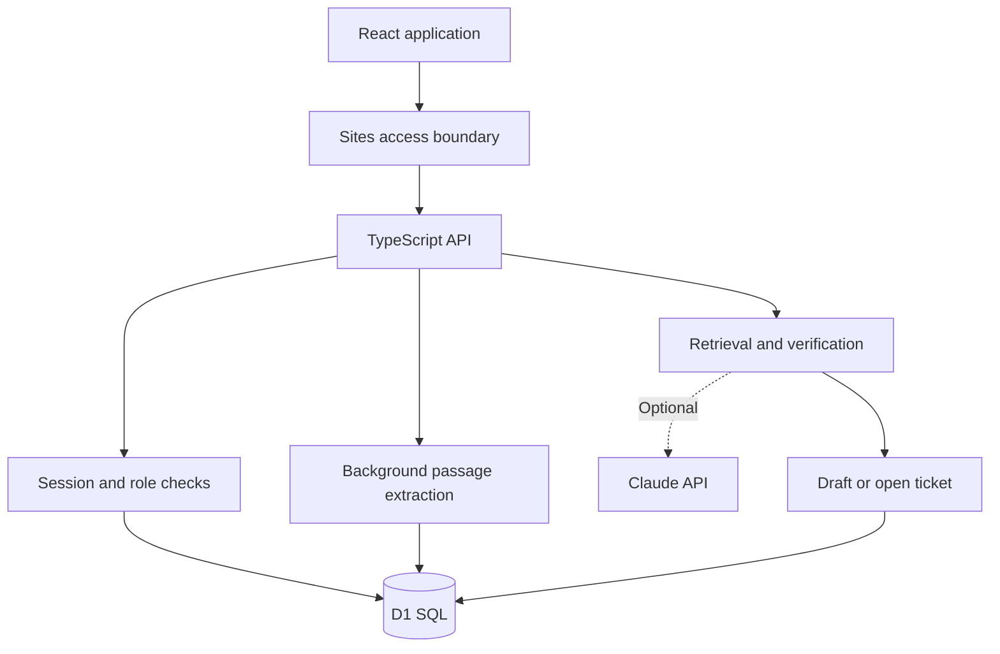
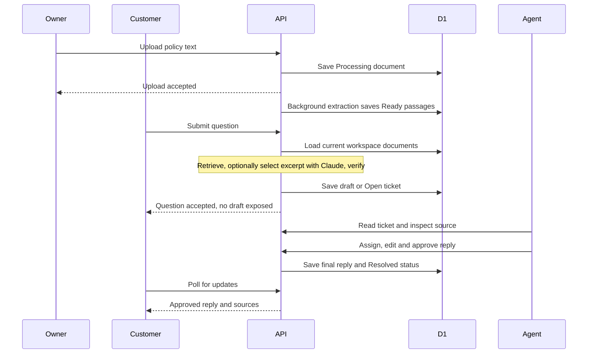
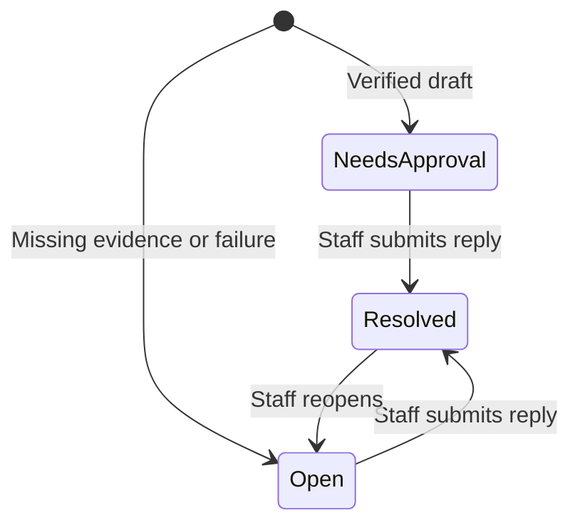
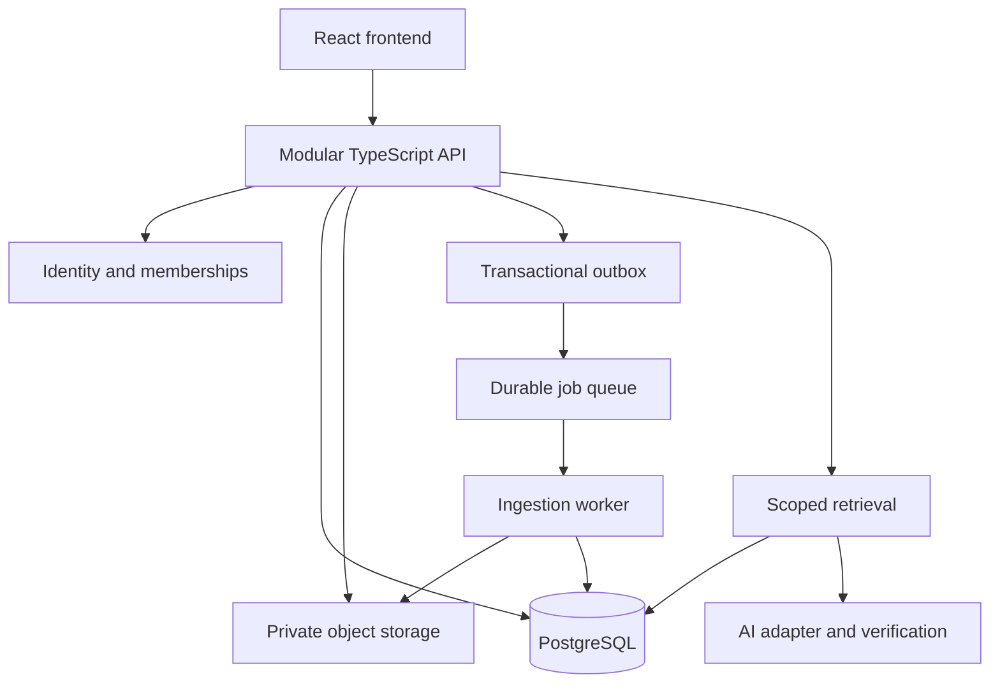

# Groundwork Support: System Architecture and Design

**Version:** 1.0 · **Date:** 19 October 2026  
**Project:** AI customer support portfolio MVP  
**Live demo:** https://groundwork-support.numan51.chatgpt.site  
**Scope:** Architecture documentation, verified against the current source. This file does not implement the proposed production upgrades.

## 1. Explain the project in 30 seconds

A business uploads its policies. A customer asks a question. The system searches that business's documents and prepares a source-backed draft. A staff member checks the evidence, edits the answer and approves it. Only then does the customer receive the reply. Questions without adequate evidence become open tickets.

The app uses a predictable workflow, not an autonomous agent. Without an AI key, the draft is a retrieved policy excerpt. An optional Claude adapter selects an excerpt, which must pass the same verification gate.

## 2. Scope and implementation status

| Capability | Current implementation | Production work still needed |
|---|---|---|
| Sign-in | Private Sites access and platform identity | Identity-provider strategy for independent deployment |
| Roles | Owner, agent and customer sample personas | Real workspace membership, invitations and revocation |
| Business isolation | SQL key combines signed-in identity and selected business | Shared organizations with membership checks and database isolation policies |
| Upload | Browser reads TXT/Markdown; sends text as JSON | Server format validation, byte limits, private object storage, optional PDF/OCR |
| Processing | Background `waitUntil` task; manual retry | Durable queue, retry policy and dead-letter handling |
| Retrieval | Keyword overlap over ready document passages | Evaluated semantic or hybrid retrieval if needed |
| AI | Exact excerpts; optional Claude excerpt selection | Live-provider testing, relevance evaluation and token-cost accounting |
| Approval | Staff explicitly submits final reply | Approval audit records and citation revalidation after edits |
| Live status | Four-second polling | Incremental polling or server-sent events at larger scale |
| Delivery | Customer portal | Optional email or other channel integration |
| Evaluations | Six synthetic fixtures and 12 automated tests | Real-provider, browser, database and load testing |

**Not running in this edition:** FastAPI, PostgreSQL, pgvector, Redis or Docker services. They must not be described as implemented infrastructure.

## 3. Current system architecture



| Layer | Responsibility | Source location |
|---|---|---|
| UI | Inbox, customer portal, knowledge, analytics, evaluations and walkthrough | `app/page.tsx` |
| Visual system | Responsive layout, themes, patterns and hover states | `app/globals.css` |
| 3D decoration | Lazy-loaded Three.js scene, pointer response, pause and cleanup | `components/maximal-scene.tsx` |
| HTTP boundary | Input checks, sessions, tenant scope and supported actions | `app/api/support/route.ts` |
| Workflow engine | Chunking, keyword retrieval, grounding and fixtures | `lib/engine.ts` |
| Persistence | Workspace aggregate and session schema | `db/schema.ts`, `drizzle/` |
| Verification | Engine tests and API tests using a D1 test double | `tests/` |
| CI | Install, test, type-check and build | `.github/workflows/ci.yml` |

The frontend uses React and the Next.js-compatible Vinext runtime. The single backend is TypeScript on Cloudflare Workers. D1 stores durable records. The browser is not the authoritative store for tickets or documents.

The Three.js scene is decorative. It does not participate in authentication, retrieval or approvals. It has a CSS fallback, bounded pixel ratio, reduced-motion support and pauses when hidden or offscreen.

## 4. Users and permissions

| Operation | Owner | Agent | Customer |
|---|---|---|---|
| Upload or retry indexing | Yes | No | No |
| View workspace documents and staff tickets | Yes | Yes | No |
| Ask a question | Yes | Yes | Yes |
| Assign, approve reply or reopen | Yes | Yes | No |
| Run evaluation suite | Yes | No | No |
| Read own customer conversations | Yes, through staff view | Yes, through staff view | Yes |

**Demo boundary:** A signed-in user can choose any sample persona inside their own sandbox. This is intentional demo switching, not real employee access management. New questions use the sample customer name `Alex Morgan`; customer filtering also uses that name. Production must use immutable user IDs and verified memberships.

## 5. Complete workflow



Every question creates a ticket. A source-backed draft gets `Needs approval`; an unsupported or failed answer gets `Open`. Neither path automatically sends a reply.

### Ticket states



`NeedsApproval` in the diagram corresponds to the stored string `Needs approval`. Assignment does not change status. Reopening currently retains the previous reply; it is not a full multi-message thread.

### Document states

An upload starts as `Processing`. Extraction changes it to `Ready` when passages exist, or `Failed` when none are produced. Retry returns it to `Processing`. The worker makes up to three immediate attempts. If those attempts fail, it can remain `Processing`; there is no scheduled retry or guaranteed recovery.

## 6. Actual database design

There are **two physical tables**, not separate SQL tables for tickets and documents.

| Table | Column | Meaning |
|---|---|---|
| `workspaces` | `id TEXT PRIMARY KEY` | Signed-in identity plus business slug |
| `workspaces` | `data TEXT NOT NULL` | JSON containing documents, tickets, events and evaluations |
| `workspaces` | `version INTEGER NOT NULL DEFAULT 0` | Optimistic concurrency version |
| `sessions` | `id TEXT PRIMARY KEY` | Random session identifier |
| `sessions` | `owner TEXT NOT NULL` | Platform-authenticated user ID |
| `sessions` | `workspace TEXT NOT NULL` | Selected demo business |
| `sessions` | `role TEXT NOT NULL` | Sample role |
| `sessions` | `expires INTEGER NOT NULL` | Expiration timestamp in milliseconds |

### Workspace JSON records

| Record | Fields |
|---|---|
| Document | `id`, `name`, `text`, `status`, `chunks[]`, `created` |
| Ticket | `id`, `question`, `customer`, `status`, `assignee`, `draft`, `reply`, `sources[]`, `reason`, `created`, `latency`, `mode` |
| Source | Document `id`, `name`, exact `quote` |
| Event | `text`, `at` |
| Evaluation | `name`, `passed`, `latency`, `detail` |

### Concurrent updates

Writes use a version check:

```sql
UPDATE workspaces
SET data = ?, version = version + 1
WHERE id = ? AND version = ?;
```

If no row changes, another request updated the workspace first. The API rejects the write and asks the user to refresh and retry. This prevents silent overwrites, but one JSON aggregate becomes a bottleneck as records and simultaneous users grow.

## 7. API contract

All current operations use `/api/support`. Reads return JSON with `Cache-Control: no-store`. Mutations use JSON bodies containing an `action` field.

| Method/action | Main inputs | Result |
|---|---|---|
| `GET` | Session cookie | Role-filtered workspace state |
| `POST login` | `role`, `workspace` | Seeds sandbox if absent; creates session cookie |
| `POST upload` | `name`, `text` | Saves document and schedules extraction |
| `POST retry` | Document `id` | Requeues background extraction |
| `POST ask` | `question` | Creates pending-approval or open ticket |
| `POST assign` | Ticket `id`, `assignee` | Assigns an allowed sample agent |
| `POST reply` | Ticket `id`, `reply` | Delivers final text and resolves ticket |
| `POST reopen` | Ticket `id` | Changes status to Open |
| `POST evaluate` | No extra input | Stores six fixture outcomes |

Example question request:

```json
{"action":"ask","question":"What is your returns policy?"}
```

Example approval request:

```json
{"action":"reply","id":"<ticket-id-from-api>","reply":"<staff-reviewed answer>"}
```

The reply operation is the approval boundary; there is no separate approval resource. It rejects already-resolved tickets and blank replies.

### Current validation and error behavior

- Question: 1–2,000 characters after the empty-input check.
- Reply: nonempty, maximum 5,000 characters.
- Upload text: nonempty, maximum 150,000 JavaScript string units; filename maximum 100 characters.
- Browser file picker also checks 150,000 bytes. The API limit is **not** equivalent to a UTF-8 byte limit.
- Session duration: 24 hours.
- Invalid mutation origin: HTTP 403.
- Other mutation failures: generally HTTP 400, including conflicts and denied actions.
- GET failures: generally HTTP 401, including some infrastructure failures.

Production should introduce schema validation and distinct 401/403/404/409/413/429/5xx responses. The current error mapping can misclassify database failures as sign-in failures.

## 8. Retrieval and AI design

1. Only documents marked `Ready` are eligible.
2. Text is divided around paragraphs and approximately 1,200-character passages.
3. Tokenization extracts English alphabetic words of at least three characters and removes a small stop-word list.
4. Candidate passages are scored by shared query words.
5. A passage must match at least `min(2, max(1, query-token-count))` query tokens.
6. The two highest-scoring candidates are returned.
7. Without provider configuration, the highest-ranked quote becomes the draft.
8. With both Claude environment values configured, the provider is asked to return one exact excerpt. The request has a 12-second timeout and a 500-token output cap.
9. A nonempty answer passes only if it is contained verbatim within one retrieved quote.
10. Missing sources, rejected output and provider exceptions become human-review cases.

**Important distinction:** Textual grounding does not prove relevance, completeness or correct interpretation. There is no calibrated confidence score. Keyword retrieval is English-oriented and does not understand synonyms reliably. This is why staff approval remains mandatory.

Customer responses omit draft text and internal reason fields. Sources remain hidden until a final reply exists. Staff may edit the draft freely; the current backend does not revalidate edited text or remove now-irrelevant citations. Production should require explicit citation review after edits.

## 9. Security and failure boundaries

| Boundary | Existing control | Remaining gap |
|---|---|---|
| Visitor identity | Trusted Sites identity header | Direct deployments need a trusted authentication boundary; never trust public client-supplied identity headers |
| Session | Random token; HttpOnly, Secure, SameSite=Strict cookie; owner and expiry checks | Session revocation, logout and expired-session cleanup |
| Tenant access | Workspace loaded from server-side session scope | Real organization membership and database policies |
| Role access | Server checks before mutation | Production membership-based roles rather than persona switching |
| SQL inputs | Bound SQL parameters | Typed schemas and normalized records |
| Cross-origin writes | Origin must equal request origin | Broader production CSRF and integration policy |
| Model output | Untrusted-input instruction and exact-source gate | Stronger relevance and adversarial evaluation |
| Secrets | Server runtime environment | Rotation and operational monitoring |
| Concurrency | Version-checked writes | Fine-grained transactions and idempotency |

A failed model call yields an open ticket only if the database save succeeds. Database failure means the request fails; the app cannot truthfully promise that a ticket was recorded. Repeated question submissions can create duplicates because there is no idempotency key.

Events are a bounded activity feed, not an immutable compliance audit log. Ordinary mutations trim the feed to 100 items; indexing can append outside that trim. Full policy text is stored in D1, not R2/object storage.

## 10. Verification and metrics

The existing suite contains 12 tests covering workflow grounding, wrong answers, missing sources, injected provider errors, role restrictions, customer draft secrecy, workspace separation and background extraction. API tests exercise the route handlers with an in-memory D1 interface double.

The dashboard runs six fixtures against seeded Northstar knowledge. It does not evaluate newly uploaded documents or call a live model. Passing those fixtures is not a production accuracy claim.

Current analytics reports retrieval/generation elapsed milliseconds for new questions, excludes seeded conversations from that mean, and shows model cost as untracked. It does not measure end-to-end browser latency, p95 latency, sustained throughput or real-world answer accuracy.

Previously completed checks: automated tests, TypeScript checking and production builds. Browser visual testing, live-provider validation, real-D1 integration testing and load testing remain unverified. CI configuration exists; a successful external CI run is not claimed here.

### Proposed acceptance gates

Before describing the product as production-ready, verify:

- A user cannot read or mutate another organization even with a known record ID.
- Customers cannot read drafts and cannot approve replies through direct API calls.
- Worker termination and duplicate delivery do not lose or duplicate indexing work.
- Approval remains idempotent under concurrent requests.
- Source changes cannot silently invalidate an approved citation.
- A human-labeled evaluation set measures answer relevance and correct escalation.
- Browser tests complete upload → question → approval → visible customer reply.
- Load tests establish measured latency and capacity before publishing performance claims.

## 11. Production target: proposed, not implemented

Retain **one TypeScript modular backend** for the lowest-risk migration. Next.js/React can remain the frontend. If FastAPI is chosen later, replace the API deliberately rather than maintaining two overlapping business-logic backends.



### Proposed normalized data model

| Entity | Essential fields and rules |
|---|---|
| Organization | ID, name, timestamps |
| User | ID, verified identity subject |
| Membership | Organization ID + user ID unique, role, status |
| Document | ID, organization ID, storage key, version, status, checksum |
| Chunk | ID, organization ID, document version, text, optional embedding |
| Ingestion job | ID, organization ID, document version, state, attempt count, last error |
| Ticket | ID, organization ID, customer user ID, assignee user ID, status, revision |
| Message | ID, ticket ID, organization ID, author, visibility, body, timestamp |
| Citation | Message ID, document version, chunk ID, quoted text |
| Approval | Draft revision, approver ID, timestamp, decision |
| Outbox event | ID, organization ID, event type, delivery state |
| Evaluation run | Dataset version, model configuration, results, usage and timestamps |

Enforce tenant-consistent relationships with constraints and scoped queries. Consider PostgreSQL row-level security as an additional layer. These are design proposals, not deployed controls.

### Queue and approval reliability

Use a transactional outbox to record a document and its enqueue intent together. Workers must deduplicate by document version, retry transient errors with backoff, and retain exhausted jobs for inspection. Write a new ready version atomically so retrieval does not see partially indexed content.

Approval should reference the exact draft revision and citation versions. Store approval, final message and delivery event in one transaction. External delivery consumers should use idempotency keys. A failed delivery must remain retryable without sending duplicate messages.

### Suggested module boundaries

| Module | Owns |
|---|---|
| Identity | Authentication adapter, sessions and memberships |
| Knowledge | Upload validation, document versions and ingestion |
| Retrieval | Query normalization, source ranking and tenant filters |
| Answering | Provider adapter, timeout, verification and escalation |
| Tickets | Assignment, conversation history and status transitions |
| Approvals | Revision validation, reviewer decision and delivery intent |
| Evaluations | Versioned fixtures, provider experiments and reports |
| Observability | Structured logs, metrics and trace correlation |

These are proposed code boundaries. The current code still concentrates UI in one page and HTTP actions in one route.

## 12. Upgrade sequence and design decisions

1. **Identity first:** replace sample switching with verified memberships and customer IDs.
2. **Data second:** normalize records and add transactional approval history.
3. **Reliability third:** durable jobs, idempotency, recovery and consistent error codes.
4. **AI quality fourth:** human-labeled datasets, live-provider tests, usage accounting; add semantic retrieval only when results justify it.
5. **Operations last:** browser and load tests, monitoring, backup recovery, retention and deployment rollback procedures.

| Decision | Reason | Cost or constraint |
|---|---|---|
| One backend | Keeps business logic understandable | Current hosted runtime differs from the original suggested Python stack |
| Exact excerpts | Makes source verification inspectable | Limited natural-language generation and semantic understanding |
| Mandatory approval | Prevents automatic publication of unchecked output | More staff effort and slower customer responses |
| Four-second polling | Simple status synchronization | Repeated full-state reads increase traffic |
| JSON workspace aggregate | Fast implementation with version checks | Large writes, coarse conflicts and limited queryability |
| Lazy decorative 3D | Meets the visual direction without controlling workflow | Extra client bundle and graphics work; fallback and motion controls are needed |

## 13. Interview explanation

“I built Groundwork as a predictable support workflow. The frontend calls one TypeScript API, which scopes data to the signed-in user's business sandbox. Uploaded policies become searchable passages. Questions produce verified excerpts or open tickets, and only staff approval publishes a response. I tested permissions, source failures and the approval boundary. My next engineering priorities are real organization membership, normalized data and durable jobs. I do not claim that the current demo already runs PostgreSQL, Redis or a fully evaluated AI agent.”
